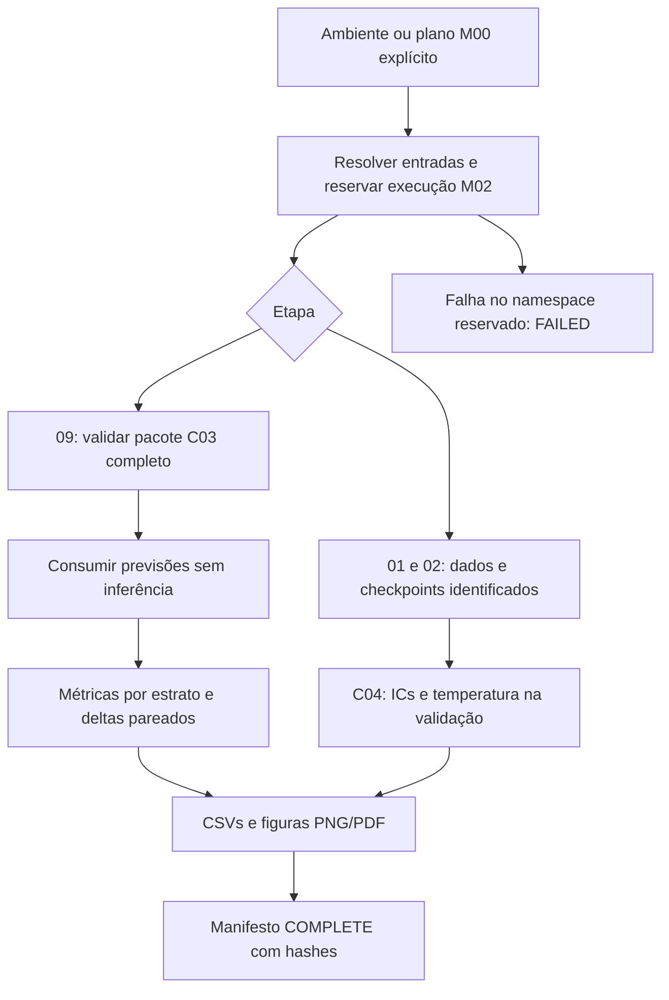

# M02 Design

**Spec**: `.specs/features/m02-benchmark-intervals-calibration/spec.md`
**Status**: Approved
**Approved**: 2026-11-09 - user: "aprovado"

## Architecture Overview

Recomendação: manter os notebooks como interfaces e extrair apenas coordenação M02 e geração de tabelas/figuras. O carregador C03 e os estimadores C04 continuam sendo a fonte dos contratos científicos. As alternativas abaixo entregam o mesmo escopo.

| Approach | Trade-off |
| --- | --- |
| A: módulos pequenos reutilizados por notebook e preflight, recomendado | Permite testar os guards antes da rodada e evita duplicar validação; adiciona apenas a camada de coordenação necessária. |
| B: toda coordenação dentro das células | Menos módulos, mas duplica regras no preflight e torna os caminhos de falha dependentes do estado das células. |
| C: migrar os três fluxos inteiros para uma CLI nova | Facilita operação em lote, mas aumenta o diff e o risco sobre fluxos científicos já existentes. |

## Code Reuse Analysis

| Component | Location | Use |
| --- | --- | --- |
| Validação C03 | `baselines/overlap.py:load_prepared_baseline_benchmark` | Reutilizar igualdade de queries, conteúdo, referências, classes, checkpoint e manifests de condições; acrescentar somente guards ausentes. |
| Métricas e IC | `baselines/paired.py` | Reutilizar evaluate_predictions, Wilson, discordância e bootstrap_species_difference. |
| Calibração | `eval/calibration.py` | Preservar TemperatureScaler, ajuste limpo na validação e selo; tornar N visível nos painéis comparativos. |
| IC C04 | `eval/uncertainty.py` | Preservar bootstrap estratificado de fragmentos; explicitar o escopo condicional. |
| Reserva e identidade | `notebook_runtime.py` | reserve_run_directory, file_identity, versões, commit e LOG_PATH. |
| Plano M00 | `run_planning.py` | load_run_plan e inspeção de etapa; integrar verificação especializada C03 com import local para não criar ciclo. |
| Fluxo M01 | `m01_workflow.py` | Referência de padrão de adoção da reserva vazia, claim exclusivo e manifesto atômico; não importar seus helpers privados. |

## Components

### C03 package inspection

**Location**: `src/viral_cnn/baselines/overlap.py`, com hooks mínimos nos preflights existentes.

Disponibilizar inspeção especializada que retorna READY/BLOCKED, caminhos, hashes e impedimentos. O notebook e os preflights usam o mesmo validador. Validar preparação, build das duas ferramentas e os 35 pares método/taxa; hash sem status explícito não equivale a conclusão. Preservar compatibilidade de aliases de ResNet apenas quando a identidade da variante/checkpoint coincide.

O preflight C00/M00 existente é de metadados. A validação especializada M02 de 09 também lê tabelas materializadas C03 para verificar igualdade de queries; isso será declarado na documentação e nos relatórios, sem iniciar modelos ou ferramentas. Não anunciar essa inspeção ampliada como metadados apenas.

### M02 run lifecycle

**Location**: `src/viral_cnn/m02_workflow.py`.

Resolver configuração/ambiente/plano para short/01, short/02 e short/09. Inputs do plano são fixados e override divergente falha. Adoção de reserva M00 exige diretório vazio, manifesto/destino/parent coerentes e claim exclusivo. Standalone usa reserva nova com UUID e permite ID explícito. Helpers begin/complete/fail são utilizados pelos notebooks, com contexto de execução que registra exceções quando a execução é controlada pelo fluxo. Documentar interrupções externas que não permitem Python executar o handler.

Fixtures smoke ficam sob raiz temporária/isolada da execução e não em DATA_ROOT compartilhado. A resolução remota padrão permanece com REMOTE_SERVER != False. A execução local dos testes força REMOTE_SERVER=False.

### Benchmark curves

**Location**: `src/viral_cnn/baselines/benchmark_plotting.py`.

Função de resumo conserva as 105 combinações (7 métodos × 5 taxas × 3 estratos), inclusive células vazias. Acurácia e cobertura ficam em proporção; IC Wilson guarda unidade e nível. Renderer recebe somente CSVs/tabelas persistidas e produz figuras separadas de acurácia e cobertura, cada qual com três painéis, N e sete métodos. Não recalcula inferência.

### Paired differences

**Location**: `src/viral_cnn/baselines/benchmark_plotting.py`, segundo componente coeso no mesmo módulo.

Exportar 150 linhas (10 pares × 5 taxas × 3 estratos). Pares são produto cartesiano das cinco CNNs com as duas ferramentas. Diferença é 100 × média(hit_CNN − hit_tool); IC de 95% por reamostragem de espécies com reposição, 2.000 repetições e seed 42. Estrato vazio ou menos de duas espécies recebe status/motivo e limites ausentes. Renderer conserva pontos sem IC quando a estimativa existe. Nenhuma média de espécies substitui silenciosamente o estimando ponderado por fragmentos.

### Notebook adapters

**Location**: três notebooks de reprodução 01/02/09.

01 conserva profiling, faixas F1 e comparações especialistas, adotando ciclo de execução M02. 02 conserva entropia/confusão/calibração e executa a demonstração GradCAM apenas em smoke, liberando o modelo nos dois modos. 09 remove a célula de injeção de ambiente e consome pacote C03 validado; código aleatório continua exclusivo ao smoke. Os três mantêm descoberta autônoma de src antes de importar viral_cnn.

## Data Models

| Record | Required fields |
| --- | --- |
| Manifesto M02 | protocol_id=m02_benchmark_audit_v1, status, notebook_id, run_id, parent_run_id, is_smoke_test, population_id, split_id, seed, git_commit, git_dirty, configuration, library_versions, inputs, checkpoints, outputs, statistical_scope |
| Identidade de arquivo | path resolvido, vínculo relativo quando dentro do namespace, size_bytes, sha256; unknown explícito quando não demonstrado |
| Resumo de curvas | method, noise_rate, stratum, n, n_covered, n_species, accuracy, accuracy_ci_low/high, coverage, coverage_ci_low/high, conditional_accuracy, ci_method, noise_realizations |
| Deltas | method_a, method_b, noise_rate, stratum, n, n_species, diff_mean_pp, ci_lower_pp, ci_upper_pp, ci_status/reason, resampling_unit, repeats, seed |

Nome de arquivo não atribui proveniência. Manifesto M02 referencia protocolo e evidência C03/C04 originais. JSON estrito usa null para medidas indisponíveis, sem NaN serializado. COMPLETE é publicado por arquivo temporário e rename apenas dentro da reserva; produto parcial nunca é descrito como completo.

## Error Handling Strategy

| Error | Handling |
| --- | --- |
| Entrada conflitante, ausente, incompleta ou corrompida | Preflight BLOCKED; avaliação interrompida sem fallback. |
| Destino ocupado | FileExistsError e preservação dos bytes existentes. |
| Falha durante fluxo reservado | Manifesto FAILED com erro; tentativa seguinte usa novo namespace. |
| Falha de renderização | Não publicar COMPLETE com figura falsa ou faltante. |
| Estrato vazio ou espécie única | Célula preservada e IC indisponível; não é falha da execução. |

## Risks & Concerns

| Concern | Location | Impact | Mitigation |
| --- | --- | --- | --- |
| Leitura repetida de hashes e tabelas de 35 condições | `baselines/overlap.py:load_prepared_baseline_benchmark` | Preflight pode custar I/O substancial | Reutilizar caches locais existentes por chamada; declarar custo e evitar nova inferência. |
| Build de base atualmente validado sob presença do vínculo | `baselines/overlap.py`, bloco database_build_manifest | Omissão do vínculo pode escapar do guard | Teste negativo removendo o vínculo e exigência explícita para as duas ferramentas. |
| mkdir exist_ok nos destinos C04 | 01/02, setup de output_dir | Sobrescrita em repetição | Reserva/claim M02 e teste com sentinela em cada notebook. |
| Smoke antigo pode sobrescrever Parquets compartilhados | 01/02, ensure_smoke_test_artifacts | Repetição do incidente M01 | DATA_ROOT smoke isolado antes de gerar qualquer fixture; snapshots em testes. |
| Alias resnet50_species vs resnet_clean_species | C03 loader e configuração | Comparação ou plot com variante errada | Canonicalização explícita da apresentação, mantendo identidade verificada do checkpoint. |
| Bootstrap por espécie custoso por 150 células | `baselines/paired.py` | Tempo adicional de CPU | Agregação existente por espécie; fixtures pequenas e repetições reduzidas somente em teste explicitamente sintético. |
| Testes antigos assumem nomes de pastas/manifestos | `tests/test_n02_benchmark_and_calibration.py` e N06 | Regressões de integração | Preservar contratos compatíveis e revisar provas afetadas sem enfraquecer asserções. |
| Interrupção de kernel impede handler de exceção | Notebooks | Reserva parcial sem FAILED imediato | Reservar com estado inicial explícito; manifesto sem COMPLETE permanece inadmissível. |

## Tech Decisions

| Decision | Choice | Rationale |
| --- | --- | --- |
| Nível da nova camada | Workflow acima de runtime/baselines | Preserva DAG de src/viral_cnn/AGENTS.md; baselines não importa workflow. |
| ICs distintos | Wilson individual, C03 espécie pareada, C04 fragmento estratificado | AD-021/022, sem mudar estimandos publicados. |
| Evidência local | Fixtures temporárias sem checkpoints canônicos | Contratos testáveis sem alegar reprodução empírica. |
| Novas figuras | Produtos M02 CSV + PNG/PDF, sem ID F | Não altera seleção C06/manuscrito nesta etapa. |
