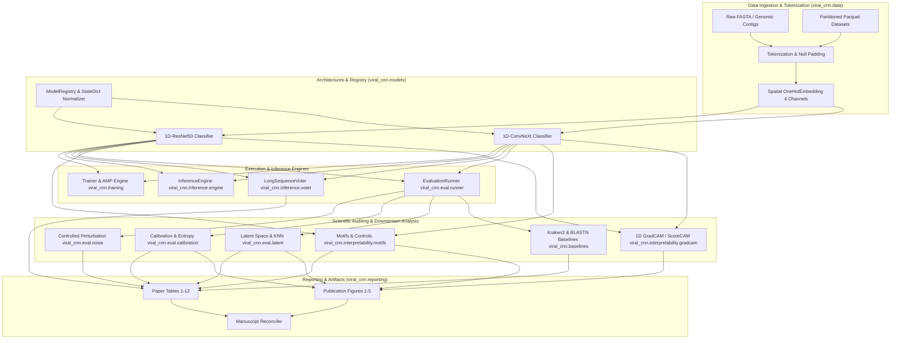
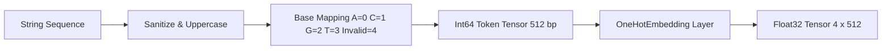
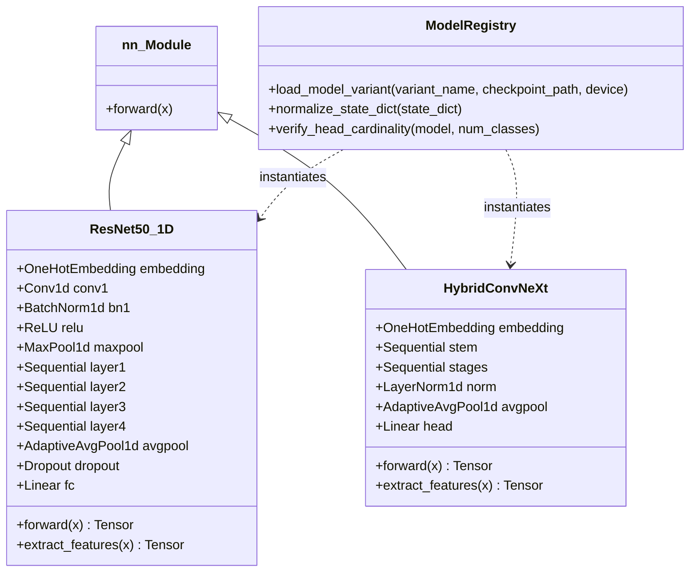
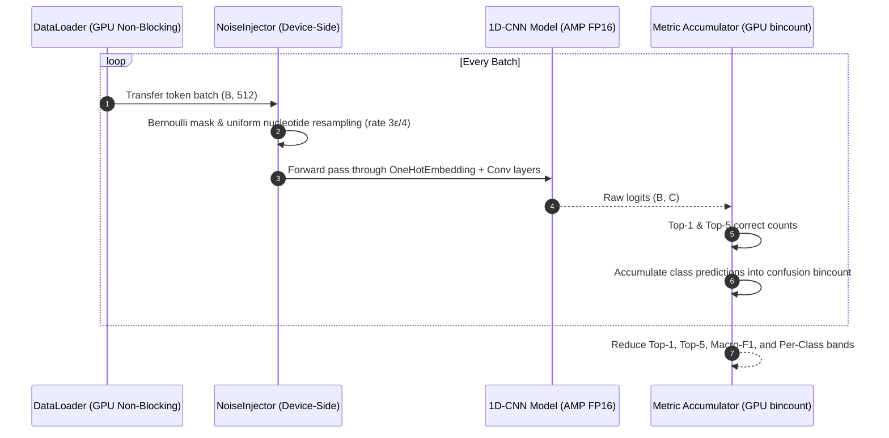
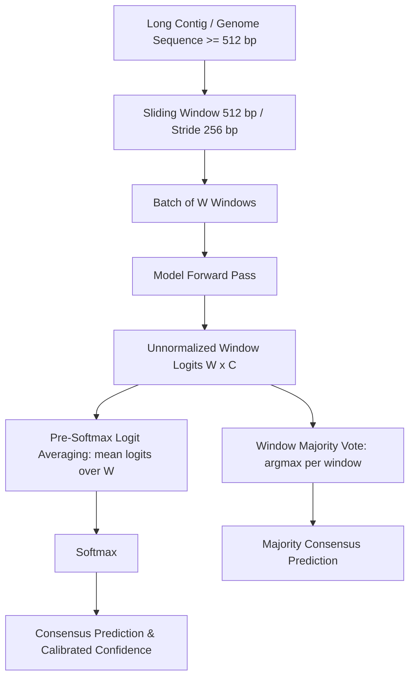
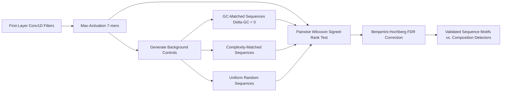
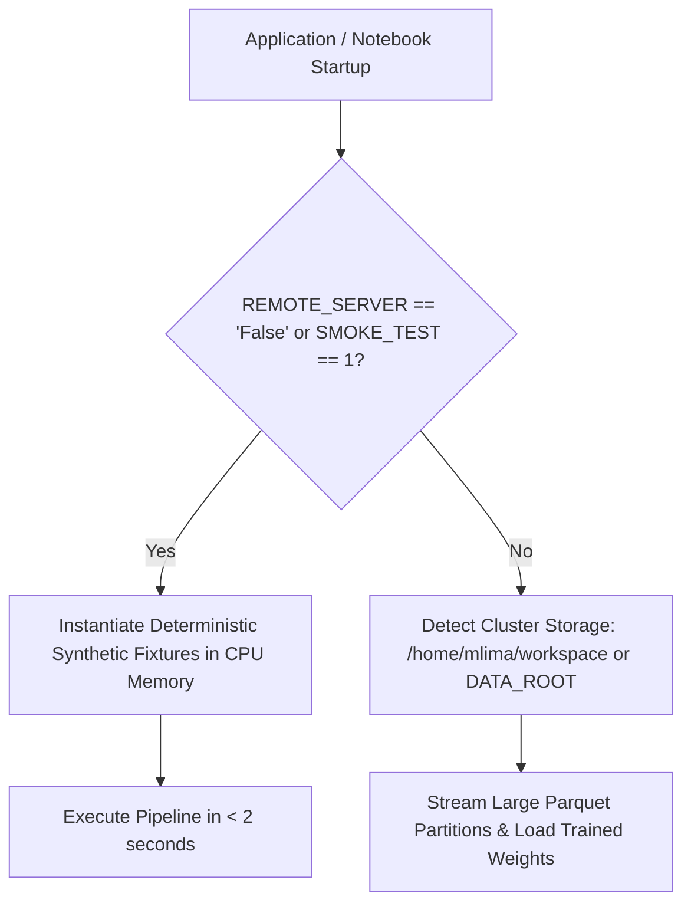

# System Architecture — `viral_cnn`

## 1. Executive Architecture Summary

`viral_cnn` is a modular, high-throughput deep learning and scientific genomics evaluation library designed for high-cardinality viral taxonomic classification from DNA sequence fragments and contigs. It powers the empirical experiments, reproducibility pipelines, and scientific audits of the manuscript:

> *"Base-level one-hot 1D convolutional networks for high-cardinality viral taxonomic classification: accuracy, corruption trade-offs, and learned sequence representations"*

The system is organized into decoupled, single-responsibility domains that enforce strict scientific invariants: spatial 4-channel nucleotide representation ($512\text{ bp} \times 4$), closed-set high-cardinality classification ($13,683$ Species / $2,702$ Genera), uniform substitution noise perturbation ($3\epsilon/4$ effective mutation rate), pre-classifier latent space analysis, and pre-softmax logit aggregation for windowed long-sequence inference.



---

## 2. Core Subsystem Architecture

### 2.1 Data Ingestion & Spatial Representation (`viral_cnn.data`)

The data subsystem handles batch loading from multi-gigabyte Parquet partitions, robust tokenization, and strict spatial 4-channel tensor encoding.



- **`viral_cnn.data.encoding`:**
  - `OneHotEmbedding(nn.Module)`: PyTorch module transforming token indices $[0, 4]$ into channel-first tensors of shape `(batch, 4, seq_len)`. Bases `A`, `C`, `G`, `T` map to standard one-hot vectors; index `4` (representing padding and ambiguous bases `N`, `R`, `Y`, `S`, `W`, `K`, `M`, `B`, `D`, `H`, `V`) is clamped and mapped to an all-zeros null vector $\mathbf{0} \in \mathbb{R}^4$.
  - Vectorized operations utilize `torch.clamp` and direct boolean indexing without redundant tensor cloning.
- **`viral_cnn.data.parquet_dataset`:**
  - `ParquetBatchIterableDataset(IterableDataset)`: Streaming dataset designed for high-cardinality multi-partition Parquet files.
  - Multi-worker disjoint partitioning: files are partitioned across PyTorch `DataLoader` workers via `torch.utils.data.get_worker_info()` to guarantee zero sample duplication.
  - Determinism & Shuffling: Deterministic testing keeps `shuffle=False` for fixed evaluation denominators ($N = 1,706,270$); training shuffling uses an isolated `random.Random(seed + worker_id)` instance.
  - Column schema tolerance: Automatically detects and prioritizes sequence columns (`"sequence_padded"`, `"padded_Representation"`, `"sequence"`) and deduplicates duplicate column names.
- **`viral_cnn.data.grouped_split`:**
  - Provides genome-disjoint stratified splitting logic and records cluster population feasibility metrics ([AD-007](file:///home/matheus/Documents/cnn_metagenome/docs/adr/AD-007-genome-split-feasibility-audit.md)).

---

### 2.2 Model Architectures & Canonical Registry (`viral_cnn.models`)

The model subsystem provides standardized 1D convolutional backbones adapted for nucleotide sequences.



- **`ResNet50_1D` (`viral_cnn.models.resnet`):**
  - 1D adaptation of Deep Residual Learning (He et al., 2016).
  - First layer: `Conv1d(4, 64, kernel_size=7, stride=2, padding=3)`.
  - Residual stages: 4 stages with bottleneck blocks `[3, 4, 6, 3]` producing 2,048 feature channels.
  - Classification head: `Dropout(p=0.5)` followed by `Linear(2048, num_classes)`.
- **`HybridConvNeXt` (`viral_cnn.models.convnext`):**
  - 1D adaptation of ConvNeXt (Liu et al., 2022).
  - Stem: `Conv1d(4, 96, kernel_size=4, stride=4)` followed by `LayerNorm1d`.
  - 4 stages of inverted bottleneck blocks `[3, 3, 9, 3]` with $7\times 1$ depthwise convolutions, GELU activations, and channel expansion factor 4.
  - Final norm and head: `LayerNorm1d(768)` followed by `Linear(768, num_classes)`.
- **`ModelRegistry` (`viral_cnn.models.registry`):**
  - Canonical access point for registered models:
    - `resnet_clean_species`, `resnet_noise_species`, `resnet_genus`
    - `convnext_zero_species` ($\text{ConvNeXt}_Z$), `convnext_transfer_species` ($\text{ConvNeXt}_T$), `convnext_noise_species` ($\text{ConvNeXt}_F$), `convnext_genus`
  - Automated state dictionary normalization: strips compiler prefixes (`_orig_mod.`), unpacks wrapper containers (`model_state_dict`), and rigorously validates head dimensions against taxonomic class counts ([AD-008](file:///home/matheus/Documents/cnn_metagenome/docs/adr/AD-008-canonical-model-registry.md)).

---

### 2.3 Evaluation, Metrics, & Robustness (`viral_cnn.eval`)

The evaluation subsystem calculates exact taxonomic metrics across nominal and controlled corruptions without introducing GPU-to-CPU synchronization bottlenecks.



- **`viral_cnn.eval.metrics`:**
  - Vectorized multiclass Macro-F1 and Weighted-F1 computation using `torch.bincount` over pre-allocated tensors on the GPU. Eliminates per-batch Python loops and `.cpu().numpy()` conversions ([AD-018](file:///home/matheus/Documents/cnn_metagenome/docs/adr/AD-018-gpu-pipeline-optimization.md)).
  - Bounded F1 bands ($[0.0, 0.2), [0.2, 0.4), \dots, [0.8, 1.0]$) continuously covering the unit interval and maintaining class sum invariants.
- **`viral_cnn.eval.noise`:**
  - `inject_substitution_noise(tokens, epsilon)`: For each base, independently mutates with probability $\epsilon$ by sampling uniformly from $\{A, C, G, T\}$.
  - Invariant contract: $P(\text{change}) = \frac{3}{4}\epsilon$.
- **`viral_cnn.eval.calibration`:**
  - `compute_multiclass_ece`: Vectorized Expected Calibration Error with equal-mass or equal-width bins.
  - `compute_brier_score`: Multiclass quadratic Brier scoring calculated in constant memory via expanded squared Euclidean norms.
  - `TaxonomyEntropyAnalyzer`: Extracts pre-classifier activations and converts them to `float32` before computing $L_1$ normalization and Shannon entropy, preventing half-precision numerical overflow in FP16 AMP ([AD-018](file:///home/matheus/Documents/cnn_metagenome/docs/adr/AD-018-gpu-pipeline-optimization.md)).
- **`viral_cnn.eval.latent`:**
  - Extracts 2,048-dim (ResNet) or 768-dim (ConvNeXt) embeddings from the penultimate pooling layer.
  - Evaluates metric organization via $L_2$-normalized Cosine $K$-Nearest Neighbors ($k=5$) using an 80/20 train/test reference split with strict self-neighbor exclusion.
  - Computes sample-constrained Silhouette scores and 2D UMAP projections ([AD-012](file:///home/matheus/Documents/cnn_metagenome/docs/adr/AD-012-latent-space-evaluation.md)).

---

### 2.4 Long-Sequence Consensus Inference (`viral_cnn.inference`)

Handles variable-length contigs and simulated reads using sliding-window decomposition and pre-softmax consensus aggregation.



- **`LongSequenceVoter` (`viral_cnn.inference.voter`):**
  - Generates overlapping 512-bp windows with standard 256-bp stride.
  - Handles short contigs ($<512$ bp) via deterministic zero-padding (`handle_short="pad"`) or exclusion (`handle_short="skip"`).
  - **Aggregation policy:** Implements `mean_logits` (averaging logits before softmax) and `majority_vote`. Pre-softmax logit averaging prevents single overconfident windows from dominating predictions and alleviates logit pulling artifacts ([AD-010](file:///home/matheus/Documents/cnn_metagenome/docs/adr/AD-010-long-voter-audit.md)).

---

### 2.5 Sequence Pattern Interpretability (`viral_cnn.interpretability`)

Audits the biological and statistical meaning of learned convolutional representations.



- **`viral_cnn.interpretability.motifs`:**
  - Extracts 7-mer sequence motifs maximizing activation in the first convolutional layer.
  - Paired background controls: Generates GC-matched ($|\Delta\text{GC}|=0$) and linguistic complexity-matched controls on the exact same sequence background. Proves that homopolymeric and extreme GC 7-mers function as bulk base-composition detectors rather than sequence-specific functional motifs ([AD-014](file:///home/matheus/Documents/cnn_metagenome/docs/adr/AD-014-compositional-controls-and-motifs.md)).
  - Exploratory Triplet Usage & RSCU: Analyzes triplet composition in frame 0 without making unverified claims of coding frame or codon bias.
  - Jaccard co-occurrence network: Evaluates undirected pairwise co-occurrence across filter activations.
- **`viral_cnn.interpretability.gradcam`:**
  - Provides 1D `GradCAM1D` and `ScoreCAM1D` attribution methods with heatmaps aligned to base-level nucleotide coordinates.

---

### 2.6 Taxonomic Curations & Mappings (`viral_cnn.taxonomy`)

- **`viral_cnn.taxonomy.mapping`:**
  - Bridges 1-based taxonomic identifiers from CSV databases (`species_name_ids.csv`, `genus_name_ids.csv`) with 0-based output logit indices:
    $$\text{model\_label} = \text{id} - 1 \quad \iff \quad \text{id} = \text{model\_label} + 1$$
  - Provides forward and inverse lookups, class name mapping, and taxonomic rank conversions ([AD-002](file:///home/matheus/Documents/cnn_metagenome/docs/adr/AD-002-csv-id-to-model-label-mapping.md)).
- **`viral_cnn.taxonomy.curation`:**
  - Merges ICTV Master Species List (MSL41) with NCBI GenBank and Kraken2 taxonomy records, auditing spelling discrepancies and synonymies.

---

### 2.7 Baseline Benchmarking (`viral_cnn.baselines`)

- **`viral_cnn.baselines.overlap`:**
  - Computes 64-bit canonical sequence hashes (using forward and reverse complement representation) to detect exact training overlaps.
  - Segregates test queries into `all`, `exact_overlap` (~95.89%), and `no_exact_overlap` subsets.
- **`viral_cnn.baselines.paired`:**
  - Executes paired cluster bootstrap resampling (2,000 iterations, seed 42) across taxonomic classes to compute 95% confidence intervals of accuracy differences between CNNs and baselines (Kraken2 / BLASTN) ([AD-011](file:///home/matheus/Documents/cnn_metagenome/docs/adr/AD-011-baseline-benchmark-protocol.md)).

---

### 2.8 Training & Optimization Subsystem (`viral_cnn.training`)

- **`Trainer` (`viral_cnn.training.trainer`):**
  - PyTorch training loop incorporating Automatic Mixed Precision (`torch.cuda.amp.GradScaler`), gradient clipping, and `CosineAnnealingLR` with linear warmup.
  - Atomic checkpoint management: saves checkpoints to temporary files before atomic replacement, preventing filesystem corruption during cluster job preemption.
- **`GPUProfiler` (`viral_cnn.training.profiler`):**
  - Profiles peak VRAM allocation, CUDA step latency, forward throughput (sequences/second), and compute-hour projections ([AD-016](file:///home/matheus/Documents/cnn_metagenome/docs/adr/AD-016-controlled-architecture-comparison.md)).

---

### 2.9 Reporting & Manuscript Reconciliation (`viral_cnn.reporting`)

- **`viral_cnn.reporting.tables`:**
  - Programmatically regenerates Tables 1 through 12 in both LaTeX `booktabs` format and CSV format.
- **`viral_cnn.reporting.figures`:**
  - Regenerates publication Figures 1 through 5 matching color palettes, font sizes, and layout specifications.
- **`viral_cnn.reporting.manuscript`:**
  - Automated reconciliation engine: compares newly generated experiment outputs against historical numbers extracted from the published PDF, logging discrepancies or confirming bit-level parity ([AD-015](file:///home/matheus/Documents/cnn_metagenome/docs/adr/AD-015-table-figure-regeneration-pipeline.md)).

---

## 3. Cross-Cutting Architectural Patterns

### 3.1 Dual Execution Topology (`REMOTE_SERVER`, AD-017)

To allow offline development and instant CI without gigabytes of data, all components utilize the execution topology pattern:



### 3.2 Observability & Artifact Traceability (`LOG_PATH`)

Every dataset, Parquet partition, CSV mapping, and model checkpoint loaded anywhere in the library logs its absolute or relative path to the console:
```text
[LOG_PATH] Loading model variant 'resnet_clean_species' from: /data/checkpoints/best_resnet.pt
[LOG_PATH] Loading ParquetDataset from: /data/splits/test.parquet (256 parts)
```
Controlled via the `LOG_PATH` environment variable (`true` by default, disabled with `LOG_PATH=0`).

### 3.3 Strict Layer Separation & Anti-Corruption Boundary

To protect the core library from notebook legacy code and ad-hoc scripts:
1. `src/viral_cnn` has **zero dependencies** on historical notebooks (`short/` or `long/`).
2. Notebooks in `notebooks/reproduction/` interact with the library strictly through public APIs (`viral_cnn.*`).
3. No module in `src/viral_cnn` uses wildcard imports (`from x import *`).
4. All model outputs and evaluation functions maintain class ordering parity guaranteed by automated unit tests.

